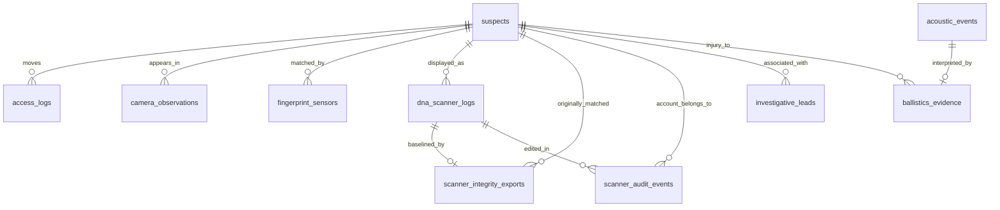

# The Shinichi Kudo Protocol
### A fictional forensic data investigation in MySQL 8.0+

> “There is always only one truth!” — *Detective Conan*

**Can a database accuse the wrong person?** In a simulated high-security facility, three shots, conflicting eyewitness accounts, and thousands of sensor readings appear to implicate an innocent visitor. A live-grip alert places that visitor on a 9mm weapon. A separate DNA-like dashboard implicates the same person through a .45 ACP weapon sample. But the two systems disagree with independent evidence.

This **original, fictional case study inspired by the deductive style of *Detective Conan*** demonstrates a reproducible SQL investigation using joins, CTEs, window functions, temporal consistency checks, and independently sourced audit evidence. It is **not** an episode adaptation, an official Detective Conan project, or a real criminal investigation.

## The puzzle (no spoilers)

- A chaotic confrontation produces two early **9mm** shots, screams, and a later **.45 ACP** shot.
- A smart-grip touch alert implicates a person who seems to be elsewhere.
- A prototype rapid-profile scanner displays the same person's identity.
- Your challenge: **separate observations, interpretations, and verified cross-source contradictions.**

**Important realism note:** The rapid DNA-like scanner is **speculative technology**. The SHA-256 strings in this database are **synthetic profile identifiers**, not biological DNA sequence analysis. Acoustic sensors only *estimate* caliber; the laboratory report provides the separate ballistics attribution. Camera footage, door logs, and exported audit records are also **simulated**, not assumed universally tamper-proof in real life.

## Database design

The five original telemetry sources are retained, with six additional corroboration sources so that one suspicious database row cannot dictate the answer.

| Table | Purpose |
| --- | --- |
| `suspects` | People, identities, fictional profile identifiers |
| `access_logs` | Time-stamped room entry and exit claims |
| `acoustic_events` | Gunshots, screams, ambient noise; tentative caliber estimates |
| `fingerprint_sensors` | *Live* weapon-grip/biometric sensor assertions |
| `dna_scanner_logs` | Potentially edited prototype scanner results |
| `door_state_logs` | Door lock/unlock state evidence |
| `camera_observations` | Independent, time-aligned presence observations |
| `ballistics_evidence` | Report-linked shot/weapon/injury evidence |
| `scanner_integrity_exports` | Independently captured **pre-edit** scanner baseline |
| `scanner_audit_events` | Separate exported database-change audit trail |
| `investigative_leads` | Source-verified motive leads, without claiming motive proved |

<details>
<summary>Entity relationships (Mermaid ERD)</summary>



</details>

`door_state_logs` and `camera_observations` deliberately join by time and room, not invented hard-coded relationships. The ERD shows declared foreign keys, not every investigative join.

## Investigation pathway

1. **Chronology** — `LAG()` and windowed `MAX()` isolate relevant events from **2,700 ambient readings**. A separate lab report identifies the shot associated with a fatal injury; *the last shot is not assumed fatal merely because it is last*.
2. **False touch alert** — a time-windowed join contrasts the smart-grip claim with a verified camera observation, the latest RFID access event, and door lock state. The conflict justifies investigation; it does not reveal the spoofing mechanism.
3. **Scanner integrity** — the editable row disagrees with a separately captured pre-edit scanner export. A verified external audit feed identifies the changed fields and account. A reversed timestamp is an anomaly, **not proof by itself of SQL injection**.
4. **The reveal** — a CTE-based query combines the fatal-shot forensic report, weapon-profile match, independently corroborated location, source-verified edit history, and the framed person's alibi. The output is a **principal person of interest**, not an automatically established criminal conviction.

## Safe installation — no data deletion

**Requirements:** MySQL **8.0.16+**, MySQL Workbench or MySQL command-line client. This project uses its **own database**: `shinichi_forensic_demo_v2`. The previous `shinichi_forensic_db` database and other databases such as `amitdb` are **not selected or modified by these scripts**.

**Safety guarantees in the supplied scripts:**

- `schema.sql` uses `CREATE DATABASE IF NOT EXISTS` and `CREATE TABLE IF NOT EXISTS`, **not `DROP TABLE` / `TRUNCATE` / `DELETE`**. Rerunning it keeps existing table contents.
- `data.sql` first confirms the project marker and checks that all 11 evidence tables are empty. It loads sample data in **one transaction**; an error causes a rollback rather than a partial import.
- Re-running `data.sql` after a successful import returns `ALREADY_SEEDED_NO_CHANGES`, without adding duplicate rows or overwriting edits. It temporarily creates/removes a *helper stored procedure*, not a data table.
- If someone has populated an evidence table without the expected installation marker state, the import **stops rather than mixing or replacing records**.
- Scripts are intentionally **not a migration system** for manually altered or incompatible table definitions. If the table layout has been changed, investigate without trying to force these seed files over it.

### Run in MySQL Workbench (recommended on Windows)

1. Connect to your local MySQL 8 server.
2. Open **File → Open SQL Script** and select `schema.sql`. Execute the **whole script** using the lightning-bolt action, then refresh **SCHEMAS**. You should see `shinichi_forensic_demo_v2` listed separately from your other databases.
3. Open `data.sql` and **execute the whole script** (it contains `DELIMITER` statements for its stored procedure). Confirm the output says `SEEDED`. To verify rerun safety, execute `data.sql` once more: it should say `ALREADY_SEEDED_NO_CHANGES`, and the verification results should remain unchanged.
4. Open `verification.sql` and run it: all **14 checks** should show `PASS`.
5. Open `investigation.sql` and execute each SELECT to investigate the clues.

### Run with the `mysql` command-line client

```bash
# Replace YOUR_USERNAME once your GitHub repository exists.
git clone https://github.com/YOUR_USERNAME/shinichi-kudo-mysql-forensics.git
cd shinichi-kudo-mysql-forensics

# Use your own MySQL account, replacing root if needed.
mysql -u root -p < schema.sql
mysql -u root -p < data.sql
mysql -u root -p < verification.sql
mysql -u root -p < investigation.sql
```

**Re-running:** `schema.sql` is non-destructive; `data.sql` is deliberately a no-op after successful seeding. To redo the mystery, use the already loaded dataset or create a *separate new demo database* rather than deleting existing records. Keep a backup before any manual database management.

The case uses fictional UTC `DATETIME(3)` timestamps on **2026-12-04**. The data loader inserts a final simulated evidence snapshot and historical export records, not a real-time event stream. Nothing in the case is a statement about real events.

## Repository files

| File | What it contains |
| --- | --- |
| [`schema.sql`](schema.sql) | Safe create-only database and table definitions, project marker, constraints, indexes |
| [`data.sql`](data.sql) | Atomic, rerun-safe load of deterministic fictional people, telemetry and a deliberately altered record |
| [`investigation.sql`](investigation.sql) | Four investigative stages; read-only queries |
| [`verification.sql`](verification.sql) | 14 read-only PASS/FAIL dataset and setup checks |
| [`findings_summary.md`](findings_summary.md) | Findings, limitations, and technical lessons |
| [`tests/test_case_logic.py`](tests/test_case_logic.py) | Optional Python/SQLite offline logic and safety checks (not a MySQL integration test) |

## Validation status

The included optional offline test can be run with Python 3 and no third-party packages:

```bash
python tests/test_case_logic.py
```

In our offline consistency run, all **six investigative queries** produced the expected fictional results and all **14 logical verification checks** showed `PASS` (after translating MySQL-specific syntax to an in-memory SQLite test harness). **This is not a substitute for running the scripts on MySQL 8.0.** In particular, verify `schema.sql`, the stored-procedure transaction in `data.sql`, and the second-run no-op behavior on your own MySQL server before publishing a tested-MySQL claim.

## Expected checks and findings

The **14 checks** in `verification.sql` should all show `PASS`. The primary investigative outputs should show **three gunshots**, an interval of **40.000 seconds** between the last scream and the fatal shot, **one** contradictory 9mm grip claim, **one** edited DNA scanner record, and **two** independent field-change audit events.

<details>
<summary>Reveal the fictional case resolution (spoilers)</summary>

**Principal person of interest:** Adrian Cross. **Deceased victim:** Viktor Hale. **Falsely displayed person:** Nora Vale. The .45 ACP shot is linked to the fatal injury by `ballistics_evidence`; Adrian appears in the Main Hall at that moment and is linked to the .45 weapon's original profile. Nora's contemporaneous camera observation, access state, and locked room contradict the smart-grip report. The separate audit feed shows changes from Adrian's assigned account, corroborated by a camera view of Adrian near the console. A verified threat-message source is a potential revenge-motive lead, not a judicial finding.

The two earlier 9mm shots are *consistent with* the reported survival confrontation; the data alone do **not** establish self-defense as a legal fact.

</details>

## Analytical lessons

**Data quality is not the same as truth.** Relational joins expose conflicting claims, but evidence provenance is essential. A timestamp reversal, DNA-like match, camera detection, or account name alone can be mistaken; each is a clue whose validity depends on source quality. This demonstration is about **SQL-based forensic data analysis and data integrity**, not OSINT (no open-source external intelligence is collected).

For limitations and threats to inference, see [`findings_summary.md`](findings_summary.md).
